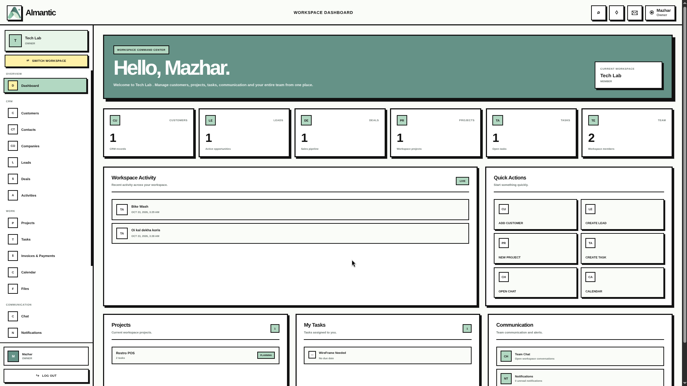
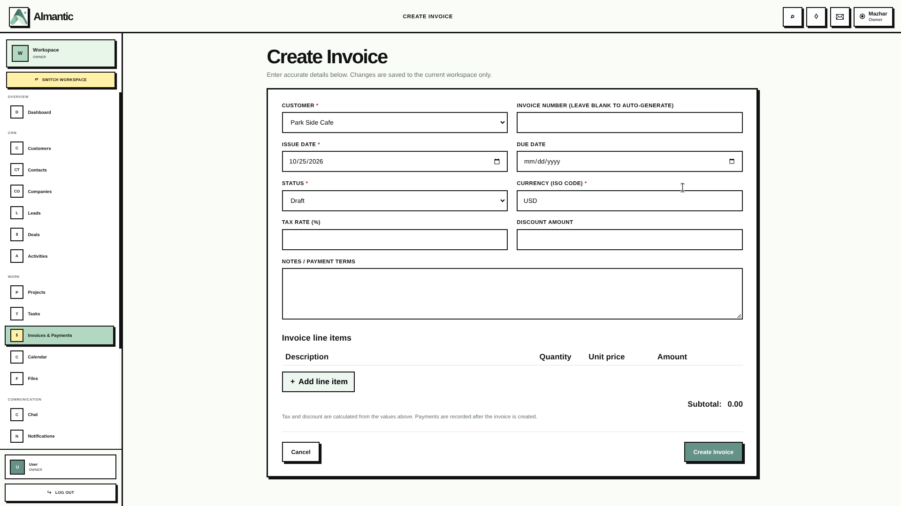
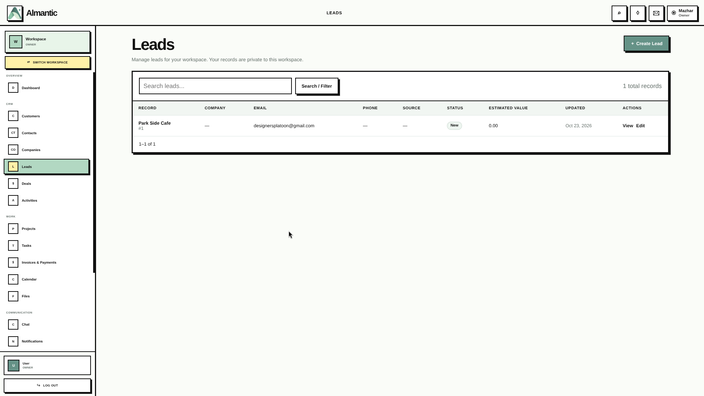
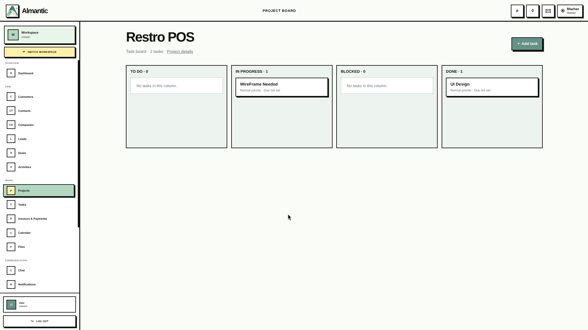
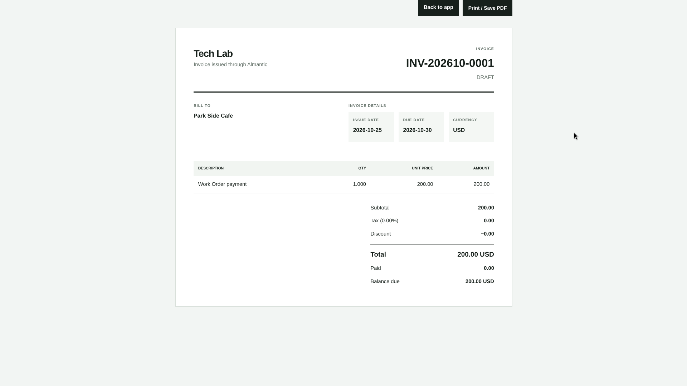
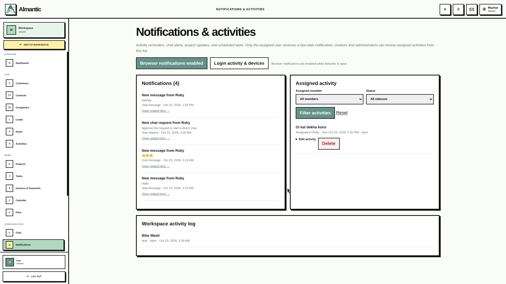
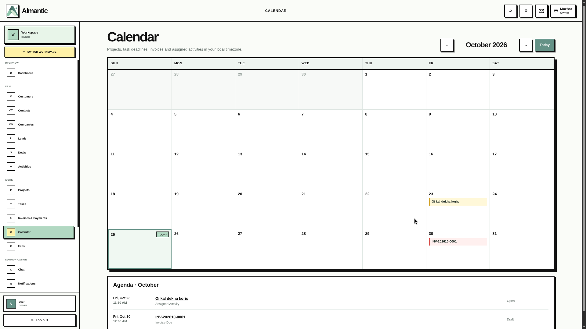

<div align="center">

# Almantic

### A Unified Workspace for Agency Operations

**CRM · Sales Pipeline · Invoicing · Projects · Tasks · Team Collaboration**

Manage leads, customers, deals, invoices, projects, tasks, files, and team conversations in one workspace—whether you're working independently or collaborating with a company.

[**Open the Live App**](https://almantic.xyz/) · [**GitHub Repository**](https://github.com/mazhar1419/almantic) · [**Contact the Developer**](https://www.linkedin.com/in/mazhar1419)


</div>

---

## At a Glance

| | |
|---|---|
| **Product** | Almantic |
| **Category** | Multi-workspace CRM and agency operations SaaS |
| **Target users** | Freelancers, small agencies, and small-to-medium businesses |
| **Live application** | [almantic.xyz](https://almantic.xyz/) |
| **Public repository** | [github.com/mazhar1419/almantic](https://github.com/mazhar1419/almantic) |
| **Application stack** | PHP 8.2+, Laravel 11, Blade, JavaScript, CSS |
| **Data layer** | MySQL/MariaDB with Laravel Query Builder and SQL migrations |
| **Source availability** | Selected repository files are public; the complete application source is not published |

## Product Overview

Almantic is a business operations platform built to bring an agency's day-to-day work into one connected workspace. Instead of managing prospects in one tool, invoices in another, project tasks in a third, and team discussions elsewhere, users can manage these workflows in one application.

A user can work in a personal workspace and also create or join multiple team and company workspaces. Workspace-scoped records and membership permissions help keep each workspace's work organized.

**The product objective:** connect the journey from lead capture and customer relationships to deals, invoicing, project execution, and team collaboration.

## Screenshots

Screenshots below are placeholders. Add genuine, current screenshots from the live app to `docs/screenshots/`, then update these paths. Use realistic sample data and remove email addresses, customer details, tokens, and other private information before publishing.

### 1. Dashboard and workspace overview



### 2. Workspace switcher and team settings



### 3. CRM: leads, customers, companies, and contacts



### 4. Deals and sales pipeline


### 5. Projects and Kanban task board



### 6. Invoice details and printable invoice



### 7. Team chat and notifications



### 8. Calendar, activities, and reports



## Try Almantic

**Live application:** [https://almantic.xyz/](https://almantic.xyz/)

1. Open the live application and register with an email address you can access.
2. Verify your email using the message sent by the application.
3. If the verification message does not appear in your inbox, check your **Spam/Junk** folder.
4. Sign in and create or select a workspace.
5. Explore the CRM, projects, invoices, calendar, files, settings, and collaboration areas available to your account.

Email delivery depends on the current mail configuration and the receiving provider. If a verification email does not arrive, check Spam/Junk and retry later.

**Please use sample information only.** Do not enter confidential customer data, payment card data, or other sensitive production information in a public demo.

## Who Is Almantic For?

- **Freelancers:** organize leads, contacts, client work, tasks, and invoices.
- **Small agencies:** coordinate sales, projects, deliverables, and team activity.
- **Consultants:** track prospects, client relationships, follow-ups, and billing.
- **Small businesses:** centralize customer records, opportunities, tasks, and operational information.
- **Teams:** separate work by workspace and manage access for different members.

## Feature Tour

### 1. Personal, Team, and Company Workspaces

Almantic's workspace model lets a user separate different areas of work rather than forcing everything into one shared account context.

- Create and select workspaces.
- Use a personal workspace for individual work.
- Create team/company workspaces for collaborative work.
- Switch between available workspaces.
- Invite members and manage workspace membership.
- Assign workspace roles such as owner and admin, with member-level access controls.
- Configure workspace settings and review workspace activity logs.

Workspace-based organization is a core product concept: CRM records, projects, tasks, invoices, files, and collaboration features are associated with a workspace.

### 2. CRM and Relationship Management

Keep customer and prospect information structured and accessible.

**Customers**
- Store customer records and contact details.
- Maintain billing information, status, and notes.
- View and edit customer records.

**Companies**
- Organize organizations associated with sales and customer relationships.
- Store company details such as website, industry, email, phone, address, status, and notes.

**Contacts**
- Keep individual contact records, including company association, job title, contact details, status, and notes.

**Leads**
- Capture prospective customers and their contact information.
- Track lead source, status, estimated value, and notes.

**Deals**
- Track sales opportunities with company/contact information, deal stage, value, expected close date, and notes.

**Activities and follow-ups**
- Record CRM activities and due dates.
- Schedule activities and manage scheduled activity records.
- Use the calendar to review time-based work.

Together, these modules help teams move from prospect information to an organized sales opportunity and ongoing customer relationship.

### 3. Projects and Task Management

Organize client delivery after a deal is won.

- Create projects and associate them with customers.
- Track project descriptions, status, priority, start and due dates, and budget.
- Create tasks linked to projects.
- Track task status, priority, due dates, and descriptions.
- Use the project task board/Kanban view to review work by status.
- Manage project membership and project-related collaboration.
- Review project and task information in reporting views.

### 4. Invoicing and Payment Records

Support the operational billing workflow from invoice creation to payment tracking.

- Create invoices for customers.
- Add invoice line items with descriptions, quantities, and unit prices.
- Calculate line-item amounts and invoice totals.
- Track invoice issue dates, due dates, status, and currency.
- Apply tax and discounts.
- Generate a print-friendly invoice view suitable for browser printing or saving as PDF.
- Record payments against invoices.
- Recalculate invoice balances and status after payments.
- Apply overpayment protection in the payment-recording workflow.

**Scope clarification:** the application records invoice payments; this should not be described as an integrated payment gateway or automatic bank/card processing unless a separate payment provider integration is added and verified.

### 5. Team Chat and Collaboration

Keep conversations connected to workspace and project work.

- Workspace chat channels.
- Direct conversation request and approval workflows.
- Project-specific chat and project membership controls.
- Message polling and conversation history.
- Conversation message search.
- Shared conversation notes.
- Conversation controls and project chat mute controls.
- Notifications for collaboration events.

The current implementation uses application-level message polling rather than advertising a WebSocket-based real-time transport. Actual delivery timing depends on the browser's polling and notification behavior.

### 6. Calendar, Activities, and Notifications

Bring time-sensitive work into a shared view.

- Month-grid calendar with previous/next month and today navigation.
- Scheduled activities and due-date visibility.
- Create, edit, and delete scheduled activities according to ownership and workspace role rules.
- In-app notification list and unread-state updates.
- Browser notifications when permission is granted and the application is open.
- Login activity history for account review.

**Push notification limitation:** the service worker can display a received push payload, and browser notifications can work while the app is open. Server-originated background Web Push delivery while the app is closed is not configured in the supplied source because VAPID keys, stored push subscriptions, and a Web Push sender are not included.

### 7. Files and Documents

- Upload workspace files.
- Store file metadata such as original filename, MIME type, size, uploader, and creation time.
- Download files through an authenticated application route.
- Delete workspace files subject to permission checks.
- Use generated storage names rather than the original filename as the stored filename.

The current source configures uploads on Laravel's local storage disk. Confirm the production disk, backup policy, file retention, and storage capacity for the deployment environment.

### 8. Reports and Operational Visibility

The reporting area provides an overview of selected business and delivery data, including project/task progress and invoice-related summaries subject to the current user's role and permissions.

Reports are intended to help an agency understand work in progress, task completion, and billing activity. They should not be represented as a complete accounting ledger or audited financial reporting system.

### 9. Account and Workspace Security Controls

The source includes application-level controls for:

- Registration, login, logout, email verification, and password reset.
- Password hashing and session-based authentication.
- Login rate limiting and login-attempt records.
- Remembered-login tokens and device/session revocation.
- Email and password change confirmation flows.
- Workspace membership and role checks.
- Module/action permission settings for members.
- Workspace activity/audit log records.
- Private file download routes and workspace-scoped data queries.

These features are documented from source inspection; a full independent penetration test and end-to-end production security certification have not been performed.

## Architecture and Engineering

### Technology

| Layer | Implementation |
|---|---|
| Server-side framework | Laravel 11 |
| Language/runtime | PHP 8.2+ |
| UI rendering | Blade templates |
| Browser behavior | Vanilla JavaScript and CSS |
| Data access | Laravel Query Builder and explicit SQL for application modules |
| Database | MySQL/MariaDB |
| Frontend build | Vite, Tailwind CSS tooling, PostCSS |
| Authentication | Custom application authentication and session flow |
| Schema changes | Numbered SQL migration files and a migration registry |
| File handling | Laravel filesystem abstraction with private local storage configuration |

### Deliberate Data-Access Approach

The application modules use Laravel's Query Builder and explicit SQL rather than relying on a domain-wide Eloquent model layer. This keeps queries visible and allows direct control over workspace filters and relational operations.

The trade-off is that authorization, relationship integrity, validation, transaction boundaries, and query correctness need disciplined implementation and testing across each module.

### Multi-Workspace Data Model

At a high level:

```text
User
├── Personal workspace
├── Agency workspace A
│   ├── Members and permissions
│   ├── CRM records
│   ├── Deals and activities
│   ├── Projects and tasks
│   ├── Invoices and payment records
│   ├── Files
│   └── Chat and notifications
└── Company workspace B
    └── Separate workspace-scoped operations
```

The database includes dedicated tables for users, workspaces, workspace members, member permissions, invitations, CRM entities, projects, tasks, invoices, invoice items, payments, files, chat, notifications, scheduled activities, audit logs, login activity, and authentication-related records.

## Repository and Source Availability

**Public repository:** [github.com/mazhar1419/almantic](https://github.com/mazhar1419/almantic)

The public repository contains selected project files and an overview of the application. The complete production application source is not published publicly.

This repository should not be interpreted as a complete self-hosting package unless all required application files, safe setup instructions, database migrations, and licensing details are intentionally published.

## Current Limitations and Production Considerations

Almantic is a substantial working application, but the following boundaries matter when evaluating it:

- Email delivery and inbox placement depend on the configured mail provider and recipient filters.
- Browser notifications do not currently include a configured server-originated background Web Push delivery pipeline.
- Chat uses polling in the supplied implementation; do not claim WebSocket real-time delivery.
- Invoice payments are recorded in the application; an external payment gateway is not included in the inspected feature set.
- Subscription checkout, recurring billing, and SaaS plan enforcement are not included in the supplied application README/source description.
- A platform-level super-admin console and complete subscription management are not included in the current release notes.
- Accounting-grade tax rules, reconciliation, and compliance workflows are outside the current documented scope.
- Full database-backed end-to-end testing against the live production environment has not been completed as part of this documentation review.
- Backups, monitoring, retention, privacy policy, terms, and incident response procedures need deployment-specific review before handling production customer data.

## Developer Notes

Almantic is built by **Mazharul Islam**, a full-stack software developer focused on practical business software and SaaS workflows.

This project demonstrates work across:
- Multi-workspace application design.
- CRM data modeling and business workflows.
- Authorization and member permissions.
- Invoice calculations and payment-state updates.
- Project/task management and Kanban-style work views.
- Collaboration features, notifications, and private file handling.
- Custom authentication and operational security controls.

Connect: [GitHub](https://github.com/mazhar1419) · [LinkedIn](https://www.linkedin.com/in/mazhar1419)

---

<div align="center">

**Almantic — one workspace for relationships, revenue, delivery, and collaboration.**

[Open Almantic](https://almantic.xyz/) · [View the public repository](https://github.com/mazhar1419/almantic)

</div>
